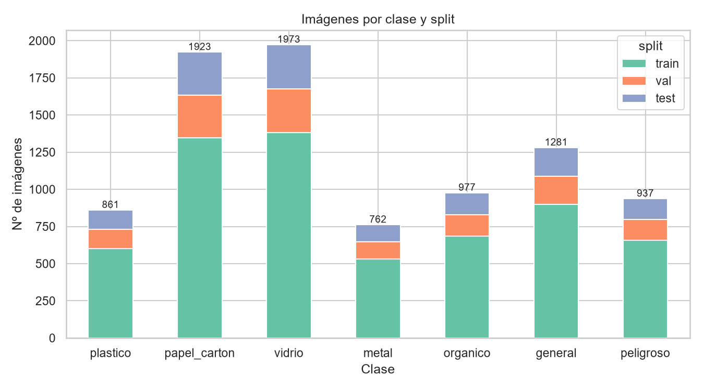
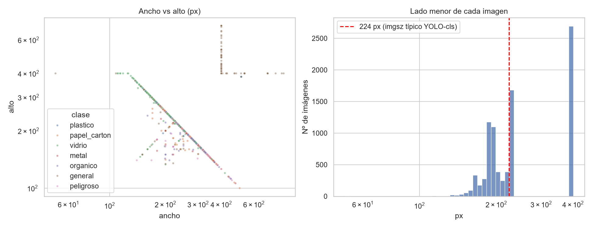
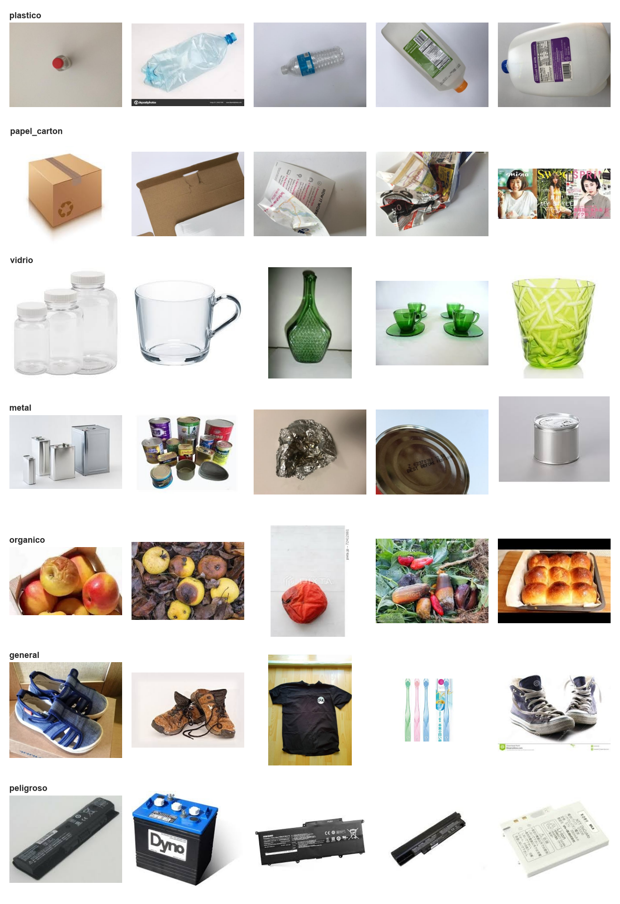

# Fase 1 — Dataset de clasificación de residuos

## Dataset de origen
- **Nombre:** Garbage Classification (12 classes)
- **Autor:** Mostafa Mohamed (usuario de Kaggle `mostafaabla`)
- **URL:** https://www.kaggle.com/datasets/mostafaabla/garbage-classification
- **Licencia:** Open Database License (ODbL) v1.0 — https://opendatacommons.org/licenses/odbl/1-0/
- **Cita sugerida:** Mohamed, M. (2021). *Garbage Classification (12 classes)* [Conjunto de datos]. Kaggle. https://www.kaggle.com/datasets/mostafaabla/garbage-classification
- Imágenes originales: **15515** en 12 clases.

| clase_original | imagenes | clase_objetivo |
|---|---|---|
| battery | 945 | peligroso |
| biological | 985 | organico |
| brown-glass | 607 | vidrio |
| cardboard | 891 | papel_carton |
| clothes | 5325 | general |
| green-glass | 629 | vidrio |
| metal | 769 | metal |
| paper | 1050 | papel_carton |
| plastic | 865 | plastico |
| shoes | 1977 | general |
| trash | 697 | general |
| white-glass | 775 | vidrio |

## Decisiones
- **Mapeo a 7 clases** (`configs/clases.yaml`): plastico, papel_carton, vidrio, metal, organico, general, peligroso. Clases excluidas: ninguna (0 imágenes).
- **Submuestreo por clase original:** {'clothes': 300, 'shoes': 300} (después de limpiar y deduplicar; semilla 42).

### battery -> nueva clase 'peligroso'
Las pilas y baterías son residuos peligrosos (contienen metales pesados y electrolitos) que no deben ir ni al contenedor de metal ni al de basura general, sino a puntos de acopio especiales. Agruparlas en 'general' haría que la app recomendara desecharlas en el tacho común, y excluirlas haría que se confundieran con metal. Una clase propia permite que la app dé la indicación correcta y deja abierta la incorporación de otros residuos peligrosos (p. ej. electrónicos o fluorescentes) en fases futuras.

### clothes y shoes -> 'general' con submuestreo a 300 imágenes cada una
Ropa y calzado no son reciclables en los contenedores domiciliarios estándar, por lo que su destino correcto es 'general'. Sin embargo, juntas suman 7302 imágenes (47 % del dataset original) frente a 697 de 'trash'; incluirlas completas haría que 'general' superara las 8000 imágenes (desbalance > 10:1 frente a metal) y que el modelo aprendiera que 'general' equivale a 'ropa'. Se toma una muestra aleatoria de 300 imágenes de cada una (semilla 42), después de la limpieza y la deduplicación para que el tamaño final sea exacto: la app reconoce textiles y calzado sin que dominen la clase. Las imágenes descartadas quedan registradas en limpieza.csv como 'excluida_por_submuestreo'.

### Otras decisiones
- **Limpieza:** se descartan imágenes que fallan en `PIL.Image.verify()` o al decodificarse. Duplicados y casi-duplicados se detectan con `imagehash`: un par se considera duplicado si `phash` **y** `dhash` (64 bits cada uno) están a distancia de Hamming ≤ 4. Se exige el segundo hash porque `phash` solo daba falsos positivos con objetos delgados sobre fondo blanco (cepillos de dientes, botellas, pilas): en la primera ejecución formó grupos de hasta 14 imágenes de clases distintas que no eran la misma foto (dhash 14–22), mientras que los duplicados reales daban dhash 0. De cada grupo se conserva la imagen de mayor resolución, y si el grupo mezcla clases objetivo distintas se eliminan todas por etiqueta ambigua. Todas las imágenes se convierten a RGB `.jpg` (calidad 95).
- **División:** estratificada por clase original, 70/15/15, semilla 42, en el formato de Ultralytics (`data/cls/{train,val,test}/<clase>/`).

## Limpieza
Total eliminadas en limpieza: **6801** (detalle en `limpieza.csv`).

- excluida_por_submuestreo: 6682
- casi_duplicado: 82
- duplicado_exacto: 31
- duplicado_conflicto_etiqueta: 6

Comprobación de fuga: pares de casi-duplicados entre splits distintos = **0**.

## Imágenes por clase y split
| clase | train | val | test | total |
|---|---|---|---|---|
| plastico | 603 | 129 | 129 | 861 |
| papel_carton | 1346 | 288 | 289 | 1923 |
| vidrio | 1380 | 297 | 296 | 1973 |
| metal | 533 | 115 | 114 | 762 |
| organico | 684 | 146 | 147 | 977 |
| general | 897 | 192 | 192 | 1281 |
| peligroso | 656 | 140 | 141 | 937 |
| TOTAL | 6099 | 1307 | 1308 | 8714 |

## Resoluciones
- Ancho: mediana 264 px (mín 51, máx 867).
- Alto: mediana 225 px (mín 100, máx 712).
- Imágenes con lado menor < 224 px: 4204 (48.2%).

Lado menor (mediana) por clase original:

| clase_original | mediana | min | max |
|---|---|---|---|
| battery | 212 | 110 | 225 |
| biological | 183 | 112 | 225 |
| brown-glass | 224 | 120 | 384 |
| cardboard | 225 | 126 | 384 |
| clothes | 400 | 400 | 400 |
| green-glass | 200 | 110 | 384 |
| metal | 384 | 106 | 384 |
| paper | 384 | 100 | 384 |
| plastic | 384 | 140 | 384 |
| shoes | 201 | 134 | 400 |
| trash | 217 | 51 | 225 |
| white-glass | 225 | 114 | 384 |

## Problemas detectados
- **Sesgo de resolución en `general`:** todas las imágenes de *clothes* tienen el lado menor = 400 px, mientras que el resto del dataset no pasa de 384 px (salvo ~19 % de *shoes*, también en `general`). Al redimensionar a `imgsz` la diferencia de tamaño desaparece, pero el estilo de foto (prendas sobre el suelo, más nitidez) puede servir de atajo al modelo. Conviene revisar la matriz de confusión de `general` tras el entrenamiento.
- **48% de las imágenes tienen lado menor < 224 px:** se recomienda entrenar con `imgsz=224` (valor por defecto de YOLO-cls); un tamaño mayor solo ampliaría imágenes pequeñas.
- **Dominio web:** buena parte de las imágenes son fotos de catálogo o de bancos de imágenes (fondo blanco, marcas de agua de iStock/depositphotos/PIXTA). La app usará fotos de cámara en entornos reales, así que se espera una caída de rendimiento fuera del dataset; se recomienda validar con fotos propias en la fase de pruebas.
- **Duplicados entre clases:** 6 imágenes aparecían idénticas en dos clases distintas (p. ej. la misma foto en *plastic* y *white-glass*); se eliminaron por tener la etiqueta ambigua.

## Ejemplos

## Desbalance
Clase mayor / clase menor = **1973 / 762 = 2.59 : 1** (vidrio vs metal).

Está por debajo del umbral de 3:1; no se requiere tratamiento.
