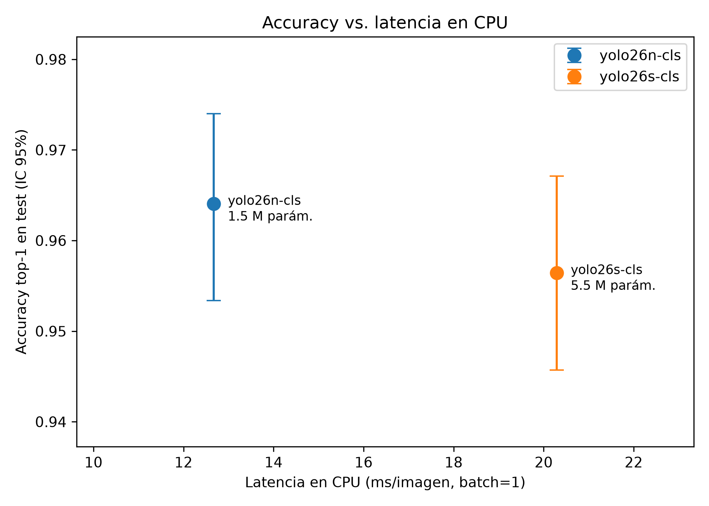

# Fase 2 — Clasificador de residuos (7 clases) con Ultralytics YOLO

## Configuración

- Modelos: yolo26n-cls, yolo26s-cls (pesos preentrenados de Ultralytics).
- Dataset: `data/cls/` de la fase 1 — train para entrenar, val para elegir el mejor checkpoint (mayor top-1 en val), test usado una sola vez para las métricas de este informe (1308 imágenes).
- imgsz=224, epochs=100, patience=20 (early stopping), batch=64, workers=2, cache='ram', seed=42, deterministic=True.
- Optimizador y aumento de datos: los valores por defecto de Ultralytics (`optimizer=auto`, que elige AdamW con lr≈0.0009 para este tamaño de dataset; RandAugment, volteo horizontal, recorte aleatorio, HSV y random erasing).
- **AMP desactivado (amp=False):** Ultralytics desactiva automáticamente la precisión mixta en la serie GTX 16xx por el riesgo conocido de loss = nan; se entrenó en FP32. No se observaron valores nan.
- Hardware: NVIDIA GeForce GTX 1650 (4 GB). Latencia medida con batch=1 sobre 200 imágenes de test tras 20 de calentamiento; en CPU con 8 hilos de PyTorch. El tiempo «total» incluye preprocesado (redimensionado y recorte) y postprocesado.

## Tiempos de entrenamiento

| modelo | épocas entrenadas | mejor época (val) | mejor val top-1 | tiempo |
|---|---|---|---|---|
| yolo26n-cls | 77 | 57 | 0.9640 | 20.7 min |
| yolo26s-cls | 59 | 39 | 0.9633 | 27.3 min |

## Resultados en test

| modelo | top-1 (IC 95%) | macro-F1 (IC 95%) | balanced acc | kappa | ms GPU | ms CPU | parámetros | MB | épocas |
|---|---|---|---|---|---|---|---|---|---|
| yolo26n-cls | 0.9641 (0.9534–0.9740) | 0.9594 (0.9472–0.9700) | 0.9594 | 0.9571 | 8.3 | 12.7 | 1.54 M | 3.1 | 77 |
| yolo26s-cls | 0.9564 (0.9457–0.9671) | 0.9497 (0.9369–0.9619) | 0.9470 | 0.9479 | 8.1 | 20.3 | 5.45 M | 10.5 | 59 |

Kappa de Cohen, MCC y ROC-AUC macro (one-vs-rest):

- **yolo26n-cls:** top-5 = 1.0000, MCC = 0.9571, ROC-AUC macro = 0.9983, GFLOPs = 0.40 (a 224 px; el resumen de Ultralytics los da a 640 px).
- **yolo26s-cls:** top-5 = 1.0000, MCC = 0.9479, ROC-AUC macro = 0.9974, GFLOPs = 1.49 (a 224 px; el resumen de Ultralytics los da a 640 px).

## Clases más confundidas

- **yolo26n-cls** (real → predicha): plastico → general (4), papel_carton → general (4), vidrio → metal (4). Detalle en `yolo26n-cls/matriz_confusion.png` y `yolo26n-cls/errores.png`.
- **yolo26s-cls** (real → predicha): plastico → vidrio (7), metal → plastico (5), vidrio → plastico (4). Detalle en `yolo26s-cls/matriz_confusion.png` y `yolo26s-cls/errores.png`.

## Análisis del atajo en `general`

Accuracy dentro de `general` (test) separada por la clase original de la fase 1. Si *trash* rindiera mucho peor que *clothes*/*shoes*, indicaría que el modelo aprendió el estilo de foto de la ropa (400 px, sobre el suelo) en lugar del concepto de basura no reciclable.

| modelo | clothes | shoes | trash | ¿sospechoso? |
|---|---|---|---|---|
| yolo26n-cls | 1.000 (n=45) | 0.978 (n=45) | 0.971 (n=102) | no |
| yolo26s-cls | 0.978 (n=45) | 0.978 (n=45) | 0.980 (n=102) | no |

- yolo26n-cls: las imágenes *trash* mal clasificadas se predijeron como {'peligroso': 2, 'organico': 1}.

- yolo26s-cls: las imágenes *trash* mal clasificadas se predijeron como {'organico': 1, 'plastico': 1}.

## Recomendación

**Se recomienda `yolo26n-cls` para la app móvil.**

- **Precisión:** en test, el modelo n obtiene top-1 = 0.964 y macro-F1 = 0.959, frente a 0.956 y 0.950 del modelo s. Los intervalos de confianza al 95 % se solapan (n: 0.953–0.974; s: 0.946–0.967), por lo que la diferencia **no es estadísticamente concluyente**: ambos modelos rinden igual dentro del margen de error. Lo mismo ocurre en validación (0.964 vs 0.963). Es decir, multiplicar por 3.5 el tamaño del modelo no aporta precisión con este dataset (~6100 imágenes de entrenamiento), que es lo esperable cuando los datos, y no la capacidad del modelo, son el factor limitante.
- **Coste:** el modelo n tiene 3.5 veces menos parámetros (1.54 M vs 5.45 M), 3.7 veces menos GFLOPs (0.40 vs 1.49 a 224 px), ocupa 3.1 MB frente a 10.5 MB y es 1.6 veces más rápido en CPU (12.7 vs 20.3 ms/imagen). En un teléfono, sin GPU dedicada, la latencia en CPU y el tamaño del archivo TFLite son lo que más importa: menos batería, menos memoria y una app más ligera de descargar.
- **Latencia en GPU:** ambos rondan los 8 ms porque en la GTX 1650 el tiempo está dominado por el preprocesado y la transferencia, no por la red; por eso esta métrica no los diferencia.
- **Riesgos que se mantienen:** las clases más débiles son *plastico* (F1 = 0.925) y *metal* (F1 = 0.930), que se confunden entre sí y con *vidrio* (envases transparentes o brillantes). Además, el dataset es mayoritariamente de fotos de catálogo con fondo blanco, por lo que antes de publicar la app conviene medir el rendimiento con fotos propias tomadas con el teléfono.
