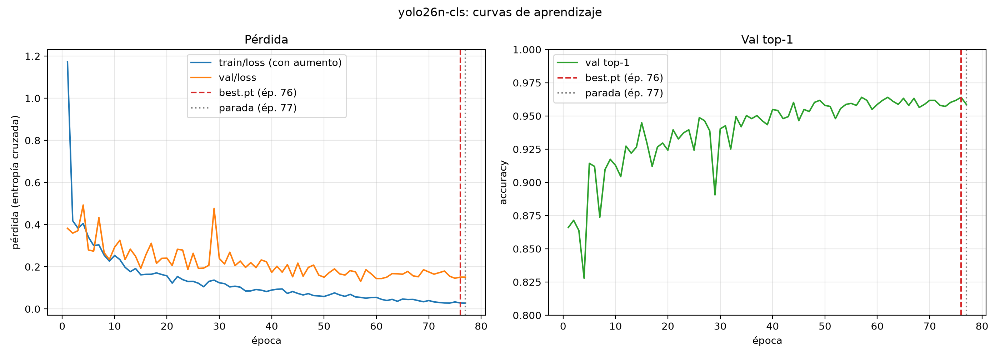
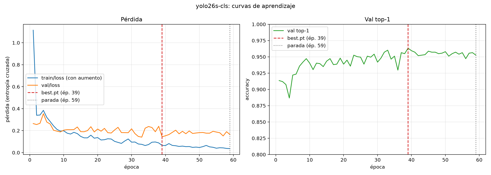
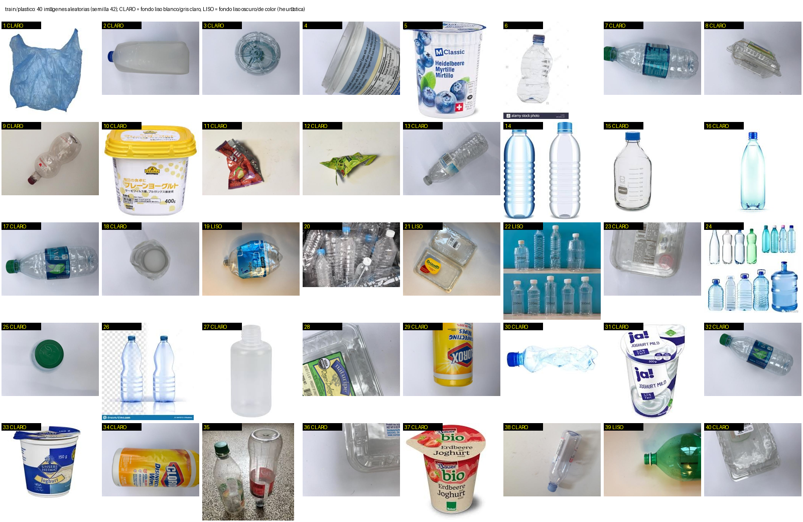
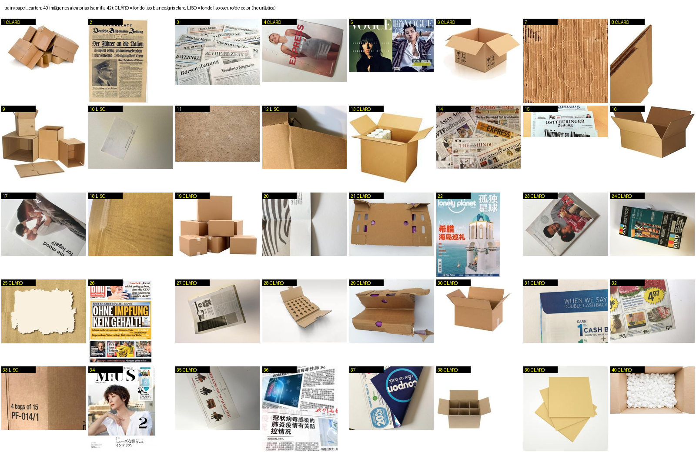
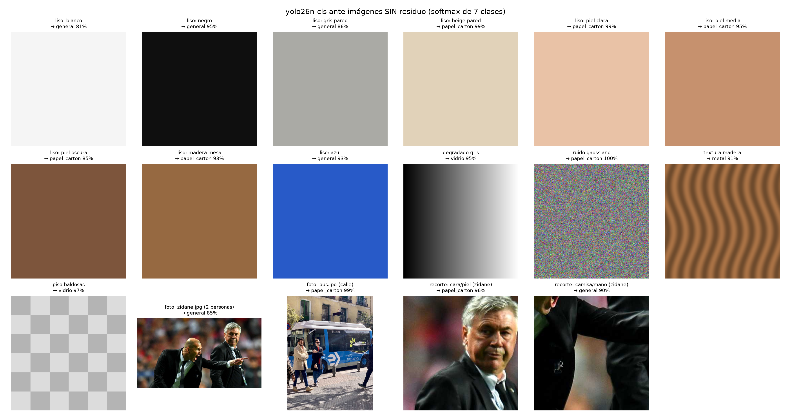

# Fase 2C — Diagnóstico del clasificador en condiciones reales

**Síntoma (celular, app EcoScan):** una mano se clasifica como *papel_carton*; el plástico opaco también
sale como *papel_carton* (solo acierta con plástico brillante/transparente).
**Conclusión:** no es un problema de sobreajuste. Es un **cambio de dominio**: el dataset son fotos de
catálogo/estudio (fondo liso, objeto aislado, sin manos) y la clase *plastico* es casi toda botella
transparente. Además, el modelo **no tiene una opción "nada/fondo"**, así que cualquier superficie
beige/marrón uniforme (piel, mesa, pared) cae en *papel_carton* con confianza alta.

Script: `scripts/11_diagnostico_cls.py` (no entrena; no reevalúa test: la accuracy de test se toma
de `reports/fase2/`). Salidas en esta carpeta.

---

## 1. Curvas de aprendizaje y brecha de generalización




`best.pt` = última época con el máximo de *fitness* = (top-1 + top-5)/2 de val (regla de Ultralytics);
la parada es 20 épocas (paciencia) después del primer máximo.

| | yolo26n-cls | yolo26s-cls |
|---|---|---|
| Época best.pt / parada | 76 / 77 | 39 / 59 |
| Época de val/loss mínima | 57 (0,131) | 33 (0,141) |
| val/loss en best.pt / última | 0,151 / 0,151 | 0,143 / 0,164 |
| **Top-1 TRAIN** (best.pt, sin aumento) | **99,98 %** | **99,93 %** |
| **Top-1 VAL** | **96,40 %** | **96,33 %** |
| **Top-1 TEST** (fase 2) | **96,41 %** | **95,64 %** |
| Brecha train − val / train − test | 3,6 pp / 3,6 pp | 3,6 pp / 4,3 pp |
| Pérdida train / val (sin aumento) | 0,0005 / 0,149 | 0,0037 / 0,141 |

Detalle por clase: `accuracy_por_clase_split.csv`, `brecha_generalizacion.csv`.

**Diagnóstico:**
- **No hay underfitting:** train ≈ 100 %, y val/test ≈ 96 %.
- **El sobreajuste es leve y está controlado.** El modelo memoriza train (pérdida ~0), pero val/loss no se dispara.
  - En n, val/loss se estabiliza en 0,13–0,15 desde la época ~55. Sube solo 0,02 entre el mínimo y el final, y la top-1 de val sigue subiendo hasta la época 76.
  - En s, val/loss sube algo más (0,141 → 0,164) tras la época 33. El early stopping se detiene a tiempo y best.pt es la época 39.
  - La brecha de 3,6 pp es normal para 6.100 imágenes. Val y test coinciden (96,4 % en n), así que el modelo generaliza **dentro de la misma distribución**.
- **La clase más débil ya en el dataset es plástico:** 89 % en val y 91 % en test con n. Tiene 3 de sus 12 errores de test hacia papel/cartón.
- **Limitación clave:** train, val y test vienen del **mismo dataset web**. El 96 % mide "fotos de catálogo nuevas", no "fotos de mi celular". Que funcione en el dataset y falle en el celular es la señal de un **cambio de dominio**, no de sobreajuste. Más regularización o más épocas no lo arreglan; hacen falta datos del dominio real.

## 2. Inspección del dataset




**train/plastico (40 aleatorias, conteo visual):**
- **Transparente o translúcido: ~25/40 (62 %).** La mayoría son botellas de agua PET. Opaco: ~12/40 (30 %), sobre todo vasos de yogur, un envase de detergente y envolturas.
- **Botellas: ~20/40.** Hay pocos tápers, bolsas o envases opacos de colores.
- **Fondo liso de estudio** (gris claro o blanco con sombra suave): ~35/40. Solo 3–4 tienen fondo real (piso de granito, montón de botellas).
- **~12/40 son fotos de banco de imágenes o catálogo** (marcas de agua de *alamy* o *dreamstime*, objetos recortados sobre blanco).
- **Manos: 0/40.**

**train/papel_carton (40 aleatorias):**
- **Periódicos y revistas: ~16/40.** Cajas de cartón de catálogo sobre blanco: ~9/40. **Primeros planos de cartón o papel kraft que llenan el encuadre: ~7/40.** Hojas sobre fondo gris claro: ~8/40.
- **Es la única clase con muchas imágenes cuyo contenido es una superficie beige/marrón uniforme sin objeto definido.** La piel, una mesa de madera o una pared beige se parecen justo a eso.
- **Manos: 0/40.**

**% de imágenes con fondo liso por clase (todo train, heurística):** se mide la textura del borde de la imagen, con el gradiente medio sobre la franja del 10 % del borde en la imagen reducida a 128 px. Liso si el gradiente es menor de 4,5; "claro" si además el gris medio es de 170 o más. Contra mi conteo manual de las 80 imágenes, acierta en papel/cartón (23 frente a ~22 de 40) y cuenta de menos en plástico (31 frente a ~35 de 40) cuando el objeto toca el borde. Por eso estos porcentajes son una **cota inferior aproximada**.

| clase | n train | fondo liso | fondo liso blanco/gris claro |
|---|---|---|---|
| plástico | 603 | **80 %** | **68 %** |
| papel/cartón | 1346 | 51 % | 40 % |
| vidrio | 1380 | 77 % | 68 % |
| metal | 533 | 76 % | 64 % |
| orgánico | 684 | 27 % | 22 % |
| general | 897 | 70 % | 58 % |
| peligroso | 656 | 72 % | 69 % |

(Por clase original: `fondos_por_clase_original.csv`. Dentro de papel/cartón, *paper* tiene 40 % de fondo liso y *cardboard* 65 %.)

**Desbalance:** plástico es la clase más pequeña (603) y papel/cartón la segunda más grande (1346), 2,2 veces más. Ante una imagen ambigua, el modelo tiende a papel/cartón.

**Experimento "plástico sin brillo"** (`plastico_sin_brillo.csv`): se usaron las 115 imágenes de val/plastico que el modelo n acierta.
- Quitando solo los reflejos (canal V recortado en su percentil 70), el 98 % sigue siendo plástico.
- Volviendo la imagen **mate** (sin reflejos, con desenfoque leve y contraste al 60 %), el **31 % deja de ser plástico**: 16 % pasa a vidrio, 8 % a metal y 4 % a papel/cartón.

Esto indica que el modelo reconoce el plástico en buena parte por **transparencia y brillo**, rasgos que el plástico opaco no tiene. Es un indicio, no una prueba completa. El salto a papel/cartón en el celular se explica sobre todo por el fondo real y la mano, que este experimento no simula.

## 3. Fuera de distribución: por qué siempre elige una clase

La última capa produce 7 *logits* y la **softmax los normaliza para que sumen 1**: p_i = e^{z_i} / Σ_j e^{z_j}. La salida siempre es un reparto de probabilidad **entre las 7 clases conocidas**. No existe la respuesta "ninguna". La confianza mide "cuánto más se parece a A que a las otras 6", no "cuánto se parece a un residuo". Una imagen sin residuo obtiene alta confianza cuando sus rasgos (color, textura) activan con fuerza una sola clase, aunque el contenido no tenga nada que ver. Las redes con ReLU suelen extrapolar con logits grandes lejos de los datos de entrenamiento, lo que **exagera** esa confianza.

Prueba con imágenes **sin residuo** (`ood_predicciones.csv`, `ood_mosaico.png`):



| entrada (sin residuo) | yolo26n-cls (app) | yolo26s-cls |
|---|---|---|
| liso piel clara / media / oscura | **papel_carton 99 % / 95 % / 85 %** | general ~30 % |
| liso beige pared / madera mesa | **papel_carton 99 % / 93 %** | general ~31 % |
| recorte de cara (piel real, foto) | **papel_carton 96 %** | **papel_carton 93 %** |
| foto de calle (bus.jpg) | **papel_carton 99 %** | **papel_carton 99 %** |
| ruido gaussiano | papel_carton 100 % | plástico 32 % |
| liso blanco / negro / gris / azul | general 81–95 % | general/vidrio ~31–35 % |
| piso de baldosas / degradado | vidrio 97 % / 95 % | vidrio 38–41 % |
| textura madera sintética | metal 91 % | papel_carton 92 % |

- **Mano:** con el modelo de la app (n), la piel y las superficies beige o marrones van a **papel_carton con 85–99 %**, muy por encima del umbral del 60 % de la app. El umbral **no** protege de este error.
- Con s, los colores lisos quedan en ~30 % y se filtrarían, pero las fotos reales sin residuo (cara, calle) siguen dando 93–99 %.
- Como referencia, en test el modelo n tiene una confianza mediana de 1,00 y el 98,7 % de las imágenes supera 0,60. Ninguna prueba de umbral distingue un residuo de "no hay nada".

---

## 4. Propuesta de mejora (no ejecutada)

### 4.1 Clase nueva `fondo` (sin residuo)
- **Objetivo: unas 800 imágenes**, similar a las clases medianas (684–897), divididas 70/15/15 como el resto.
- **Contenido:** manos vacías (abiertas, cerradas, palma y dorso, distintos tonos de piel), mesas (madera, melamina, vidrio), pisos (cerámica, cemento, parquet), paredes, ropa, teclado o escritorio, encuadres de la calle o el aula.
- **Origen:**
  - ~300 fotos propias con el celular.
  - ~200 de manos de un dataset abierto (HaGRID; ver 4.4).
  - ~200 texturas de DTD (wood, tiles, marble, fabric, paper-like… **excluyendo** cualquier categoría que contenga residuos).
  - ~100 escenas de interior.
- **En la app:** si la clase es `fondo`, mostrar "Apunta la cámara a un residuo". El umbral del 60 % se mantiene para las dudas entre residuos.

### 4.2 Fotos reales con el celular (en carpetas separadas)
```
data/real_train/<clase>/   ← SOLO entrenamiento (se suma a train)
data/real/<clase>/         ← SOLO test final (no se usa nunca para entrenar ni elegir modelo)
data/real_objetos.csv      ← archivo, carpeta, clase, objeto_id, fondo, luz, mano(si/no)
```
- **Cantidades:** **real_train: 150 por clase** (mínimo 100), es decir 7 × 150 + 150 de `fondo` ≈ **1.200 fotos**. **real (test): 40 por clase** (mínimo 30), ≈ **320 fotos**.
- **Sin fuga de información:** cada **objeto físico** va a una sola de las dos carpetas (`objeto_id`). La carpeta `real/` se fotografía otro día y en otro lugar. Unos 3–5 encuadres por objeto, así que hacen falta 30–50 objetos distintos por clase para real_train.
- **Variación obligatoria por clase:**
  - ~40 % con la **mano sosteniendo el objeto**, en **todas** las clases, para que la mano deje de ser señal de papel/cartón.
  - Fondos: mesa, piso, pared y mano, cada uno en ~25 %.
  - 2 iluminaciones (día y luz artificial) y 2 distancias.
- **Plástico:** al menos el **50 % opaco** (yogur, detergente, shampoo, tápers, bolsas, envases de colores, tecnopor si se clasifica ahí) y el resto transparente.
- **Al entrenar:** sobremuestrear real_train ×3 (copias o `WeightedRandomSampler`) para que pese frente a las ~6.000 imágenes web.
- **Métrica principal del informe:** accuracy y matriz de confusión **en `data/real/`** antes y después (con `scripts/07_evaluar_real.py`).

### 4.3 Aumento de datos
Configuración actual: `RandomResizedCrop` con scale=0.5 (área 50–100 %), fliplr=0.5, RandAugment y erasing=0.4. **Con RandAugment activado, Ultralytics desactiva el ColorJitter (hsv_*).**
- **Recortes más agresivos:** `scale=0.75` (área 25–100 %), para ver el objeto parcial o de cerca, como en el celular.
- **Volteo vertical:** `flipud=0.5` (la orientación de un residuo es arbitraria).
- **Borrado aleatorio:** `erasing=0.5`, para simular oclusión por dedos.
- **Color:** comparar en **val** (no en test) RandAugment frente a `auto_augment=None` con `hsv_h=0.03, hsv_s=0.7, hsv_v=0.5`. Este jitter cambia el tono y la luz más directamente y ayuda con la piel, la iluminación cálida y el balance de blancos del celular.
- **El cambio de mayor impacto es el reemplazo de fondo (copy-paste), generado offline:**
  1. Las imágenes con fondo liso claro (~68 % de plástico) se recortan con umbral o con un segmentador (p. ej. `rembg`).
  2. Se pegan sobre fondos reales: las fotos de `fondo`, DTD y fotos de mano.
  3. Se genera ~1 imagen sintética por cada original de fondo liso, **solo en train**.

  Esto rompe el atajo "fondo de estudio" y enseña el objeto sobre mesas y en la mano.

### 4.4 Datasets abiertos para combinar
Verificar la licencia y la versión antes de descargar, y quitar duplicados con pHash frente a data/cls, como en la fase 1.

| dataset | qué aporta | uso propuesto |
|---|---|---|
| **RealWaste** (UCI ML Repository, 2023; ~4.750 fotos, 9 clases; CC BY 4.0) | Residuos reales de un relleno sanitario, fondos sucios y variados. Clases cardboard, paper, plastic, metal, glass, food organics, textile, misc… | Combinar con el mapeo de clases.yaml. Es la mejor fuente de "residuo real" para clasificación |
| **TACO** (Trash Annotations in Context; ~1.500 fotos, ~4.800 objetos, 60 categorías; CC BY 4.0) | Basura en contexto (calle, playa, pasto), a veces sostenida en la mano. Tiene cajas y máscaras | Recortes por caja para clasificación. Sobre todo para la **Fase 3 (detección)** |
| **HaGRID** (gestos de mano; cientos de miles de fotos, interiores variados; CC BY-SA 4.0) | Manos de muchas personas y tonos de piel sobre fondos caseros | Subconjunto de ~200 para la clase `fondo` |
| **DTD** (Describable Textures Dataset; 5.640 imágenes, 47 texturas) | Madera, baldosa, mármol, tela… | Clase `fondo` y fondos para el copy-paste |
| Garbage Classification v2 (Kaggle, ~20k imágenes web, 10 clases) | Más variedad de objetos, incluido plástico opaco | Opcional. Es del mismo dominio web que el actual, así que ayuda poco con el problema real |

No conviene añadir TrashNet: es del mismo estilo de estudio que el dataset actual.

### 4.5 Orden sugerido
1. Tomar `data/real/` (test) **primero** y medir el modelo actual. Esa es la línea base del informe.
2. Tomar `data/real_train/` y armar la clase `fondo`.
3. Reentrenar yolo26n-cls (mismo protocolo de la fase 2, amp=False) en dos variantes, comparadas en **val**: (a) solo datos nuevos y `fondo`; (b) además, copy-paste y el aumento ajustado. Las fuentes externas se añaden en un tercer paso si hace falta.
4. Evaluar una sola vez en test y en `data/real/`, y reexportar a TFLite con la ruta de la fase 2B. Las labels cambian (8 clases, con `fondo` en orden alfabético) y la app las toma del archivo, así que solo habría que añadir `fondo` en `lib/config/clases.dart`.
