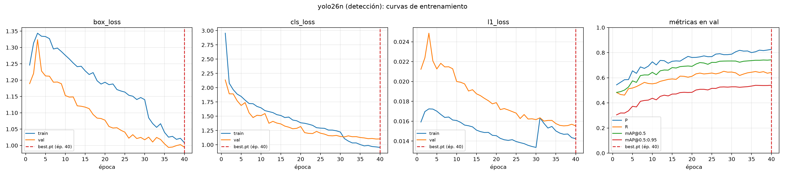
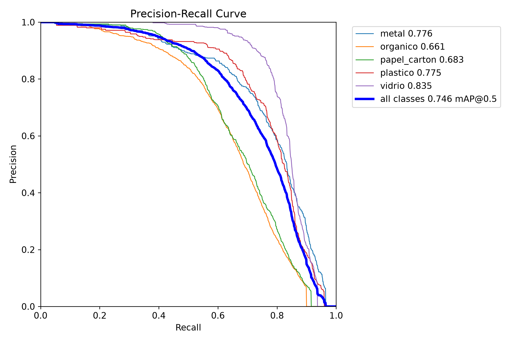
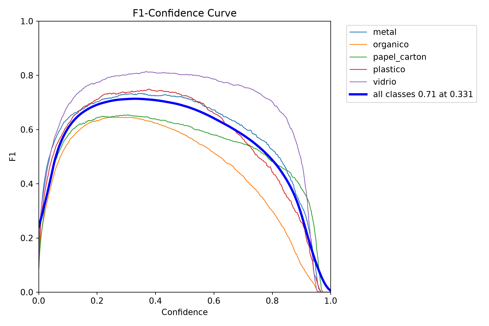
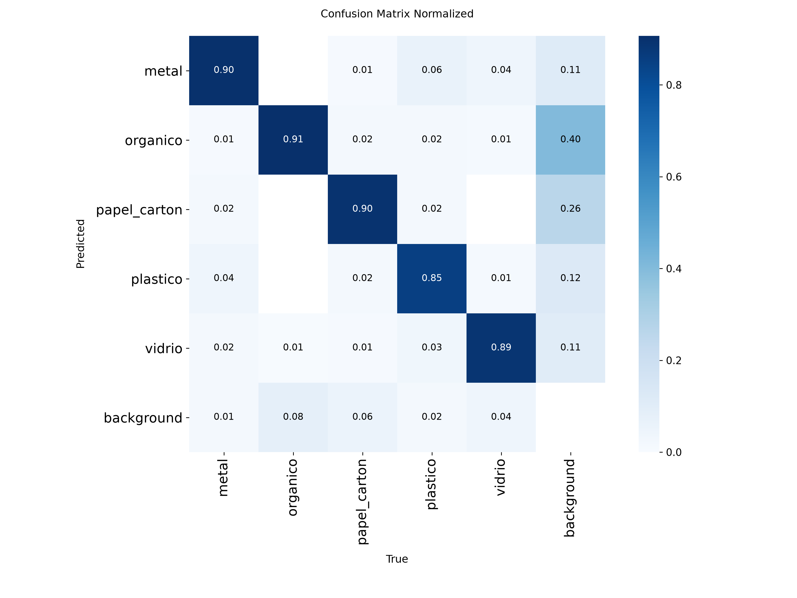
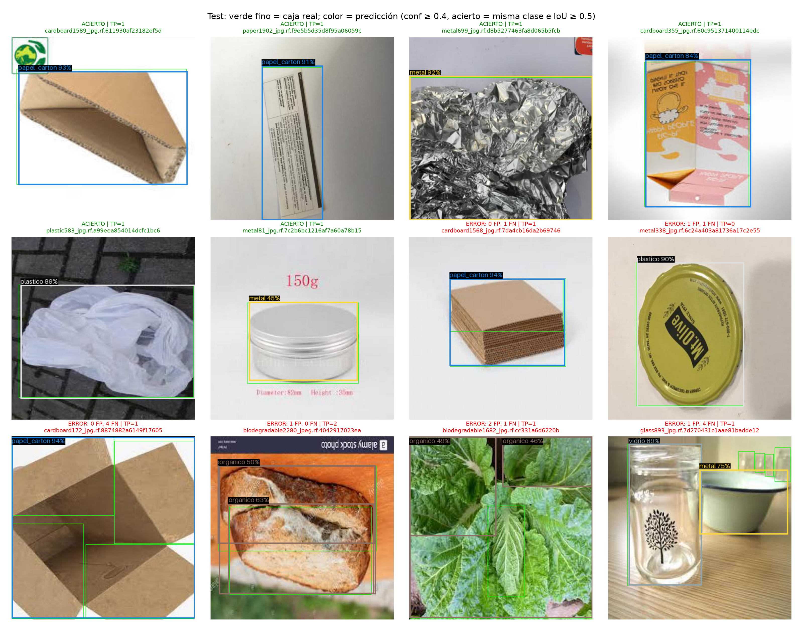

# Fase 3 — Detector de residuos (yolo26n)

## Datos y entrenamiento

- Dataset: `data/det/` (Kaggle viswaprakash1990/garbage-detection, CC BY 4.0; ver `reports/datasets.md`), 5 clases, split 70/15/15 propio (`scripts/12_preparar_det.py`).
- `yolo26n.pt` (COCO) → ajuste fino con imgsz=416, batch=8, épocas máx. 40, paciencia 10, AMP desactivado, semilla 42, cache=disk (NVIDIA GeForce GTX 1650).
- Entrenadas 40 épocas en 107 min; best.pt = época 40 (máximo mAP@0.5:0.95 en **val** = 0.540).

## Métricas en TEST (evaluación única)

P y R son las del umbral de confianza que maximiza F1 (criterio de Ultralytics); mAP con IoU 0.5 y 0.5:0.95.

| clase | imágenes | cajas | P | R | mAP@0.5 | mAP@0.5:0.95 |
|---|---|---|---|---|---|---|
| metal | 281 | 752 | 0.755 | 0.709 | 0.776 | 0.579 |
| organico | 308 | 3162 | 0.793 | 0.539 | 0.661 | 0.407 |
| papel_carton | 487 | 1343 | 0.825 | 0.537 | 0.683 | 0.523 |
| plastico | 219 | 711 | 0.787 | 0.699 | 0.775 | 0.581 |
| vidrio | 403 | 1013 | 0.844 | 0.773 | 0.835 | 0.654 |
| **todas** | 1698* | 6981 | **0.801** | **0.651** | **0.746** | **0.549** |

\* imágenes de test (una imagen puede contener varias clases).

Clases más débiles (mAP@0.5:0.95): **organico** y **papel_carton**.

| Curva PR | F1–confianza |
|---|---|
|  |  |

## Ejemplos en test

Umbral de la app (conf ≥ 0.4). Verde fino = caja real; color de clase = predicción.

## Rendimiento (PC de desarrollo, batch=1, imgsz 416)

| | GPU | CPU |
|---|---|---|
| ms por imagen (total) | 15.1 | 29.8 |
| ms por imagen (solo inferencia) | 12.0 | 27.2 |

- Parámetros: 2.54 M · GFLOPs: 2.5 · tamaño del .pt: 5.2 MB.
- GPU: NVIDIA GeForce GTX 1650. Los ms en el celular se miden en la app (ver más abajo).

## Exportación a TFLite

Detalle en [exportacion/exportacion_tflite.md](exportacion/exportacion_tflite.md). Se usa `models/export/basura_det.tflite` (FP32, 9,3 MB): con el umbral de la app (conf ≥ 0,4) reproduce el 100 % de las detecciones del .pt en test (IoU medio 1,000); el mAP@0.5:0.95 baja 0,76 pts (0,549 → 0,541) solo por las cajas de baja confianza que entran en el cálculo del mAP. La salida es [1, 9, 3549] (sin la cabeza end2end) y el plugin le aplica su NMS nativo.

## Limitaciones

- Mismo dominio que el clasificador: fotos de estudio/catálogo, casi siempre 1 objeto con fondo liso (ver fase 2C). En la cámara del celular con fondos reales el rendimiento será menor que estas cifras.
- No hay clases `general` ni `peligroso` en detección (el dataset no las tiene).
